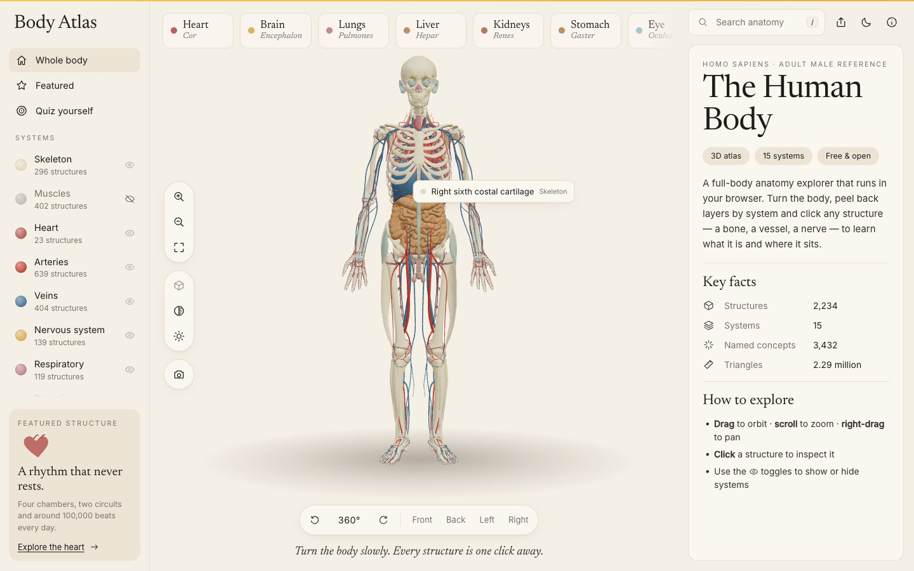
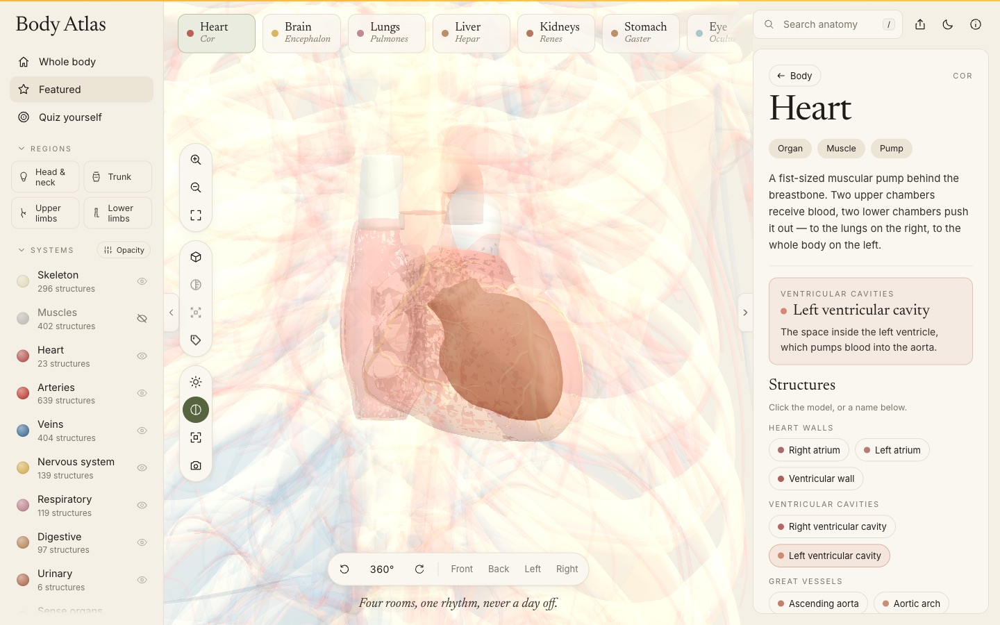
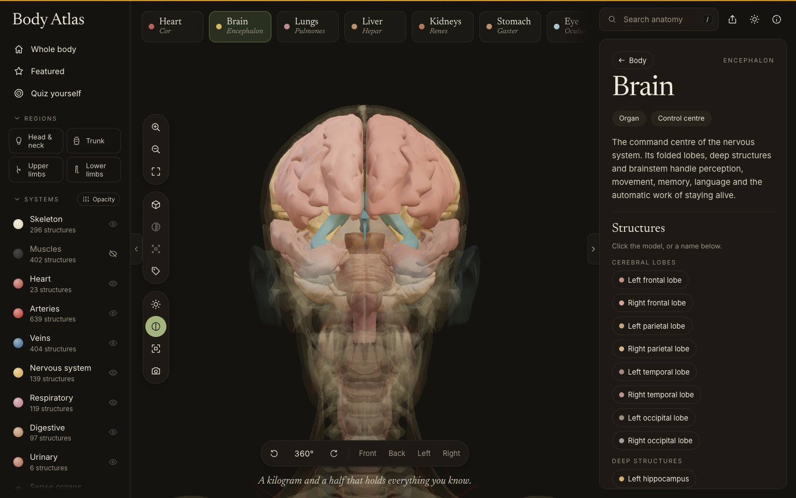
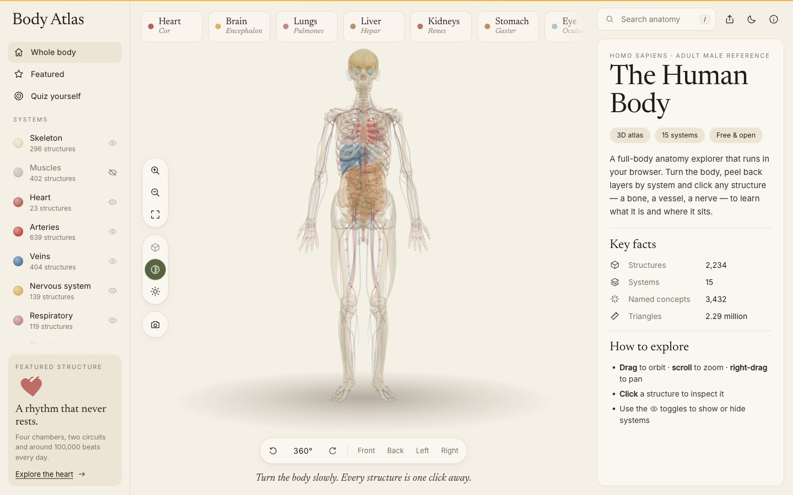
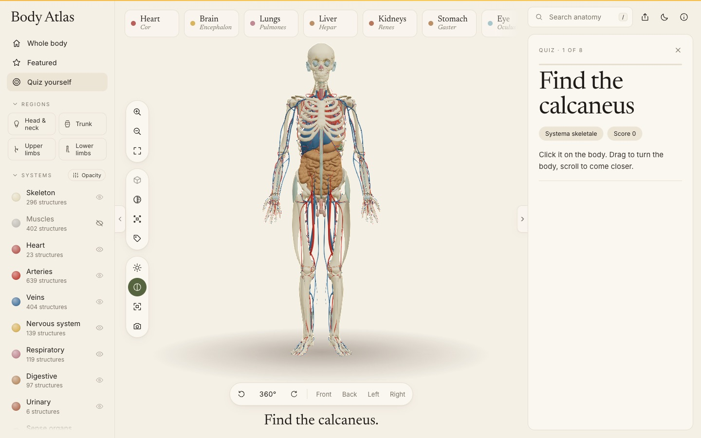
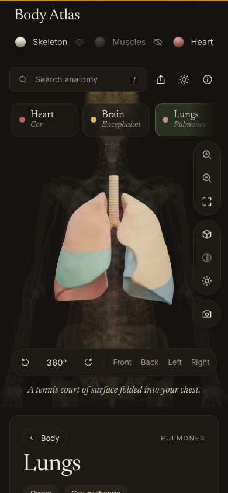
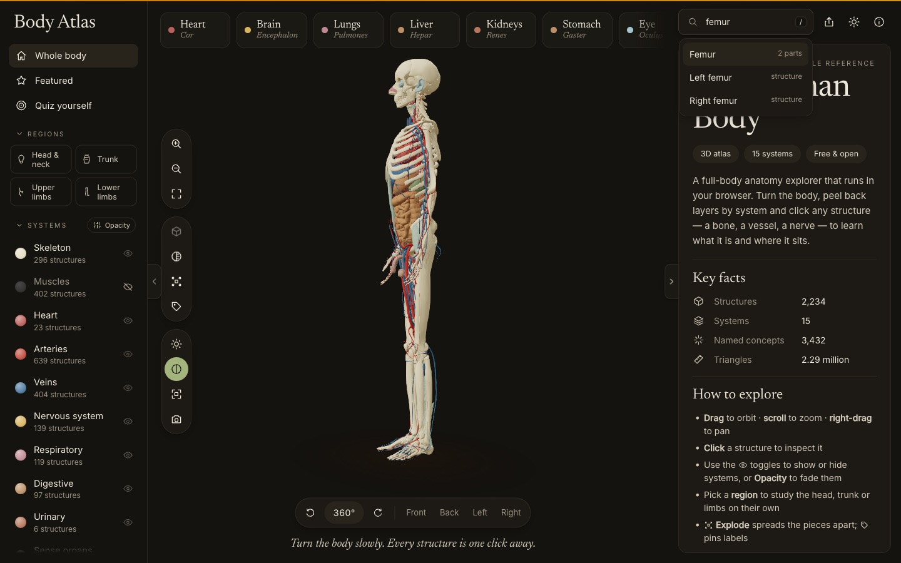
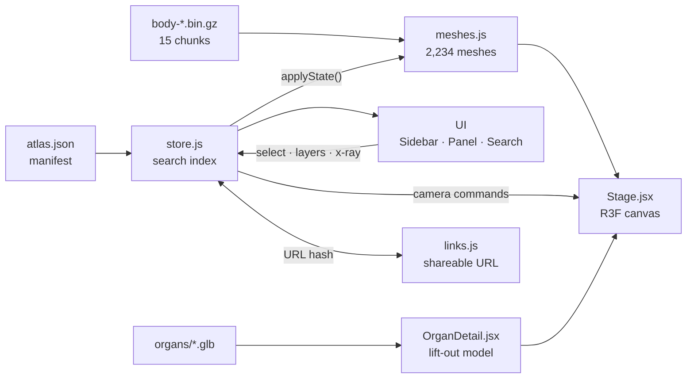

<div align="center">


# Body Atlas 3D

**Explore the human body in 3D — right in your browser.**

Turn a full adult body, peel it back system by system, click any of 2,234 structures,
and open 14 organs in detailed models you can take apart. No install, no plugin.

[](https://react.dev)
[](https://threejs.org)
[](https://github.com/pmndrs/react-three-fiber)
[](https://vitejs.dev)
[](https://nodejs.org)
[](public/ATTRIBUTION.md)

[Features](#-features) · [Quick start](#-quick-start) · [Shortcuts](#-keyboard-shortcuts) · [How it works](#-how-it-works) · [Project structure](#-project-structure) · [Roadmap](#-roadmap)

<br />

<picture>
  <source media="(prefers-color-scheme: dark)" srcset="docs/screenshots/overview-hover-dark.jpg" />
  
</picture>

<sub>The hero image follows your GitHub theme — light or dark.</sub>

</div>

<br />

## ✦ At a glance

<table>
  <tr>
    <td align="center"><b>2,234</b><br /><sub>selectable structures</sub></td>
    <td align="center"><b>15</b><br /><sub>body systems</sub></td>
    <td align="center"><b>3,432</b><br /><sub>searchable names</sub></td>
    <td align="center"><b>14</b><br /><sub>organ deep-dives</sub></td>
    <td align="center"><b>2.29 M</b><br /><sub>triangles, in-browser</sub></td>
  </tr>
</table>

<table>
  <tr>
    <td width="50%"></td>
    <td width="50%"></td>
  </tr>
  <tr>
    <td align="center"><sub><b>Organ deep-dive</b> — click a part to read about it</sub></td>
    <td align="center"><sub><b>Dark theme</b> — the brain, lobe by lobe</sub></td>
  </tr>
</table>

## ✦ Features

**See**
- **Whole-body model** — 2,234 meshes from BodyParts3D 4.0, grouped into 15 systems.
- **System layers** — show or hide any system; muscles and skin start hidden so the organs show.
- **X-ray mode** — every layer turns translucent so you can see what sits behind what.
- **Preset views** — front, back, left, right, plus a 360° turntable.
- **Light & dark themes** — follows your system, remembered per browser.

**Learn**
- **Hover labels** — the name and system of whatever is under the mouse.
- **Search** — instant, across every structure and named group ("femur", "aorta", "left kidney").
- **Organ deep-dives** — 14 organs lift out of the body as labelled models; the heart beats and the lungs breathe while you read.
- **Quiz yourself** — eight "Find the …" rounds with hints and a final score.

**Share**
- **Shareable links** — the URL always matches what is on screen.
- **Save image** — export the current 3D view as a PNG.

**Built right**
- **Keyboard first** — every tool has a shortcut; press <kbd>?</kbd> for the list.
- **Reduced motion** — `prefers-reduced-motion` turns every animation into an instant cut.
- **Graceful fallback** — without WebGL, panels, search and facts still work and the page says why.
- **Mobile layout** — search on top, the body in the middle, details below.

<table>
  <tr>
    <td width="37%"></td>
    <td width="37%"></td>
    <td width="16%"></td>
  </tr>
  <tr>
    <td align="center"><sub><b>X-ray</b></sub></td>
    <td align="center"><sub><b>Quiz</b> — a hint after a miss</sub></td>
    <td align="center"><sub><b>Mobile</b></sub></td>
  </tr>
</table>

## ✦ Quick start

> **Requires** Node.js 18+ and npm.

```bash
git clone https://github.com/ImliStack/Body-Atlas-3D.git
cd Body-Atlas-3D
npm install
npm run dev        # → http://localhost:5180
```

The first visit downloads ~31 MB of compressed geometry (15 chunks, with a progress bar);
after that it comes from the browser cache.

| Script | What it does |
|---|---|
| `npm run dev` | Dev server with hot reload on port 5180 |
| `npm run build` | Static production build into `dist/` |
| `npm run preview` | Serve `dist/` locally on port 5180 |

## ✦ Using the atlas

<details open>
<summary><b>Explore the body</b></summary>
<br />

Drag to orbit · scroll to zoom · right-drag to pan. Click any structure to select it: the camera
flies in, the rest of the body fades back, and the panel shows its system, region, side, size and
the larger groups it belongs to. The **eye** icons in the sidebar switch systems on and off;
clicking a system's name focuses it with a short introduction.



</details>

<details>
<summary><b>Open an organ</b></summary>
<br />

Click an organ in the body or a quick pick along the top. The click flashes, the body steps
back, the camera springs in and a detailed model lifts out in the organ's place. Click its parts —
heart chambers, lung lobes, brain lobes — to read about each. **← Body** or <kbd>Esc</kbd> plays
the move in reverse.

Heart · brain · lungs · liver · kidneys · stomach · pancreas · spleen · gallbladder · bladder ·
eye · esophagus · intestines · larynx.

</details>

<details>
<summary><b>Quiz yourself</b></summary>
<br />

Choose **Quiz yourself** in the sidebar. Each round asks for one structure: a first-try find
scores 1, a second try ½, and after two misses the answer is shown with a hint. Hover labels
switch off during the quiz so they can't give the answer away.

</details>

<details>
<summary><b>Share a view</b></summary>
<br />

The URL hash follows what's open — copy it from the address bar or use the share button.

| Link | Opens |
|---|---|
| `#organ/heart` | An organ deep-dive (`heart`, `brain`, `lungs`, `liver`, …) |
| `#featured/skull` | A featured structure (`skull`, `spine`, `femur`) |
| `#concept/femur` | Any named group, lower-case and URL-encoded (`#concept/left%20kidney`) |
| `#part/FJ1252` | One mesh by its BodyParts3D id |
| `#system/venous` | A body-system overview |

Unknown links fall back to the whole body. Updates use `replaceState`, so clicking around
doesn't flood the browser history.

</details>

## ✦ Keyboard shortcuts

| Key | Action | | Key | Action |
|:---:|---|---|:---:|---|
| <kbd>/</kbd> | Search | | <kbd>R</kbd> | Auto-rotate |
| <kbd>Esc</kbd> | Back / clear | | <kbd>I</kbd> | Isolate selection |
| <kbd>F</kbd> | Fit to view | | <kbd>X</kbd> | X-ray |
| <kbd>+</kbd> <kbd>−</kbd> | Zoom | | <kbd>L</kbd> | Studio lighting |
| <kbd>1</kbd> – <kbd>4</kbd> | Front · back · left · right | | <kbd>P</kbd> | Save image |
| <kbd>T</kbd> | Light / dark theme | | <kbd>?</kbd> | Shortcuts & credits |

In search, <kbd>↑</kbd> <kbd>↓</kbd> move through results and <kbd>Enter</kbd> opens one.

## ✦ How it works



| Piece | Approach |
|---|---|
| **Geometry** | BodyParts3D meshes are pre-packed into 15 gzipped binary chunks plus a JSON manifest (names, systems, byte offsets, bounds). Three workers fetch them in parallel; `DecompressionStream` unzips them when the host hasn't; each part becomes a zero-copy `BufferGeometry`. |
| **Rendering** | All 2,234 meshes live in one plain `THREE.Group` that React never reconciles. `applyState()` flips visibility, material and render layer in one pass, using shared per-system materials (solid · ghost · glow · x-ray). |
| **Picking** | [three-mesh-bvh](https://github.com/gkjohnson/three-mesh-bvh) powers hover and click. Trees are built in `requestIdleCallback` slices after load; faded layers are skipped so a click lands on what you can see. |
| **Camera** | [camera-controls](https://github.com/yomotsu/camera-controls) (via drei) handles fly-to, fit-to-box and preset views, padding small structures so a single tooth still shows its jaw. |
| **State** | One [zustand](https://github.com/pmndrs/zustand) store holds selection, layers, quiz, theme and camera commands. Every selection runs the same timeline: *press → clear → fly → lift → reveal → hold*. |
| **Motion** | Every duration lives in [`src/motion.js`](src/motion.js). The organ lift is a damped spring with slight overshoot; heartbeat and breathing are small procedural scale curves. |

## ✦ Project structure

```text
Body-Atlas-3D/
├── index.html                  App shell, fonts, meta tags
├── package.json
├── vite.config.js
├── PLAN.md                     Research notes and milestones
├── docs/
│   ├── logo.svg
│   └── screenshots/            Images used in this README
├── public/
│   ├── ATTRIBUTION.md          Full data credits
│   ├── models/
│   │   ├── atlas.json          Manifest: parts, systems, offsets, bounds
│   │   └── body-*.bin.gz       15 packed geometry chunks
│   └── organs/
│       ├── *.glb               14 organ models
│       └── ATTRIBUTION.md      Per-model licences
└── src/
    ├── main.jsx                React entry
    ├── App.jsx                 Layout, search, quick picks, tools, shortcuts, loader
    ├── store.js                Zustand store, search index, selection timeline, quiz
    ├── links.js                URL hash ⇄ current view
    ├── data.js                 Systems, colours, featured structures, quiz rounds
    ├── organs.js               Organ copy, facts, idle animation, quick picks
    ├── organ-models.json       Organ parts, groups, colours, credits
    ├── motion.js               All timings + spring / heartbeat / breathing
    ├── styles.css              Design tokens (light + dark), layout, components
    ├── scene/
    │   ├── Stage.jsx           Canvas, lights, picking, camera rig, PNG export
    │   ├── meshes.js           Chunk loading, materials, BVH, applyState()
    │   ├── OrganDetail.jsx     Lifted-out organ: fade, spring, idle, part picking
    │   ├── organLoader.js      Cached GLB loading
    │   └── fx.js               Shared animated values (fade, flash, dissolve)
    └── ui/
        ├── Sidebar.jsx         Navigation, system layers, quiz entry
        ├── Panel.jsx           Overview, system, selection, organ and quiz views
        └── Icon.jsx            24 px stroke icon set
```

**Where to start reading:** [`src/store.js`](src/store.js) for behaviour,
[`src/scene/meshes.js`](src/scene/meshes.js) for the 3D body,
[`src/ui/Panel.jsx`](src/ui/Panel.jsx) for what the right column shows.

## ✦ Customising

| To… | Edit |
|---|---|
| Add a quiz round | `QUIZ` in [`src/data.js`](src/data.js) — title, BodyParts3D concept names, system, hint |
| Change the quick picks | `PICKS` at the end of [`src/organs.js`](src/organs.js) |
| Retune an animation | The value in [`src/motion.js`](src/motion.js) — every move reads from there |
| Re-colour a system | Its `color` in `SYSTEMS` in [`src/data.js`](src/data.js) — 3D materials and UI follow |
| Change theme colours | CSS custom properties at the top of [`src/styles.css`](src/styles.css) (`:root[data-theme='dark']` for dark) |

## ✦ Browser support & deployment

Works in current **Chrome, Edge, Firefox and Safari** on desktop and mobile; WebGL must be
available (it is unless hardware acceleration is off). Device pixel ratio is capped at 2.

`npm run build` emits a fully static site in `dist/` — deploy it to **Vercel, Netlify,
Cloudflare Pages or GitHub Pages** with no server and no environment variables. Hosts that
serve `.gz` with `Content-Encoding: gzip` and hosts that serve it as plain binary both work.

## ✦ FAQ

<details>
<summary><b>Why is the first load ~31 MB?</b></summary>
<br />
The model is real scan-derived anatomy — 2.29 million triangles — not a stylised mannequin.
It streams in 15 chunks with a progress bar and is cached by the browser afterwards.
</details>

<details>
<summary><b>Can I use it for medical decisions?</b></summary>
<br />
No. It is a learning tool built on a single adult male reference body. Real anatomy varies
between people.
</details>

<details>
<summary><b>Is there a female body?</b></summary>
<br />
Not yet. BodyParts3D is a male reference model; a female reference (HuBMAP, CC BY 4.0) is
noted in <a href="PLAN.md">PLAN.md</a> as a candidate.
</details>

<details>
<summary><b>Why no 3D on my machine?</b></summary>
<br />
Your browser has WebGL switched off — usually hardware acceleration is disabled. The rest of
the atlas still works and the page tells you what to change.
</details>

## ✦ Roadmap

- [x] Whole-body model, system layers, search, selection
- [x] Organ deep-dives with labelled parts and idle motion
- [x] Hover labels, preset views, x-ray, quiz, shareable links, PNG export, dark theme
- [ ] Exploded view that spreads the visible pieces apart
- [ ] Browse by region — head & neck, trunk, upper and lower limbs
- [ ] Labels pinned to the model with leader lines
- [ ] Per-layer opacity sliders
- [ ] Fewer draw calls by merging static meshes
- [ ] One static page per system for search engines, offline cache (PWA)

Research notes and earlier milestones are in [PLAN.md](PLAN.md).

## ✦ Contributing

Issues and pull requests are welcome.

1. Fork the repo and create a branch: `git checkout -b feature/your-idea`
2. Run `npm run dev` and make your change
3. Check `npm run build` passes
4. Open a pull request describing what changed and why

## ✦ Data & credits

| Source | What | Licence |
|---|---|---|
| [BodyParts3D 4.0](https://lifesciencedb.jp/bp3d/) — © DBCLS | Whole-body anatomy | CC BY 4.0 |
| [ashemag/human-atlas](https://github.com/ashemag/human-atlas) | Packed browser geometry | MIT code · CC BY 4.0 data |
| [OrganUI](https://github.com/organui) | Organ models | MIT code · CC BY 4.0 / CC BY-SA per model |
| Google Fonts | Newsreader, Inter | OFL |

Full attribution: [`public/ATTRIBUTION.md`](public/ATTRIBUTION.md) and
[`public/organs/ATTRIBUTION.md`](public/organs/ATTRIBUTION.md).

> [!IMPORTANT]
> **Educational use only.** Body Atlas is a learning tool, not a clinical or diagnostic
> reference.

<div align="center">
<br />
<sub>Made with care by <a href="https://github.com/ImliStack">ImliStack</a></sub>
</div>
