<div align="center">


# Body Atlas 3D

**Explore the human body in 3D — right in your browser.**

Turn a full adult body, peel it back system by system or region by region, pull it apart,
pin labels to it, click any of 2,234 structures and open 14 organs in detailed models.
Installs as an app and keeps working offline. No plugin.

[](https://react.dev)
[](https://threejs.org)
[](https://github.com/pmndrs/react-three-fiber)
[](https://vitejs.dev)
[](https://nodejs.org)
[](#-using-the-atlas)
[](https://body-atlas-3d.imlistack.workers.dev)
[](public/ATTRIBUTION.md)

**[▶ Open the live app](https://body-atlas-3d.imlistack.workers.dev)**

[Features](#-features) · [Quick start](#-quick-start) · [Shortcuts](#-keyboard-shortcuts) · [How it works](#-how-it-works) · [Project structure](#-project-structure) · [Roadmap](#-roadmap)

<br />

<picture>
  <source media="(prefers-color-scheme: dark)" srcset="docs/screenshots/overview-dark.jpg" />
  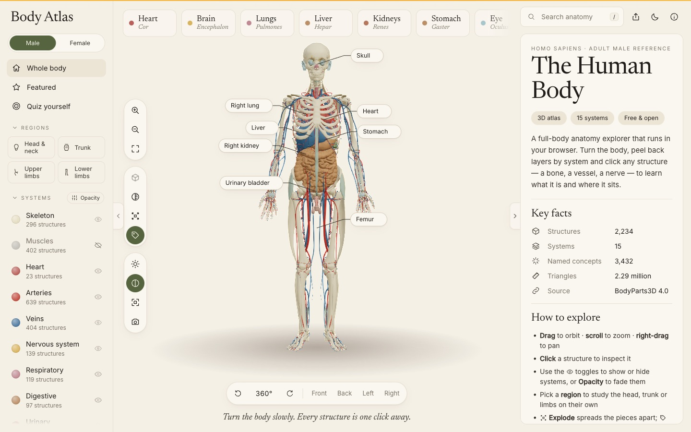
</picture>

<sub>The hero image follows your GitHub theme — light or dark.</sub>

</div>

<br />

## ✦ Demo

<div align="center">
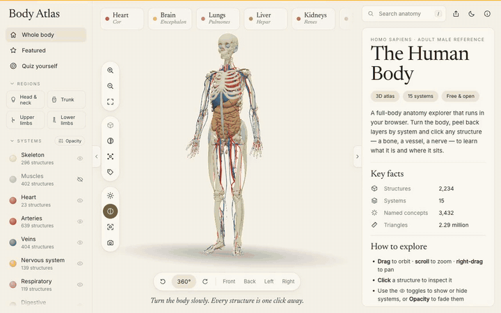
<br />
<sub>~50 seconds: turntable → pinned labels → exploded view → regions → layer opacity → skull spread apart → heart deep-dive → focus mode · <a href="docs/demo.mp4">full-quality MP4</a></sub>
</div>

## ✦ At a glance

<table>
  <tr>
    <td align="center"><b>2,234</b><br /><sub>selectable structures</sub></td>
    <td align="center"><b>15 + 4</b><br /><sub>systems + regions</sub></td>
    <td align="center"><b>3,432</b><br /><sub>searchable names</sub></td>
    <td align="center"><b>14</b><br /><sub>organ deep-dives</sub></td>
    <td align="center"><b>~14</b><br /><sub>draw calls for 2.29 M triangles</sub></td>
  </tr>
</table>

<table>
  <tr>
    <td width="50%">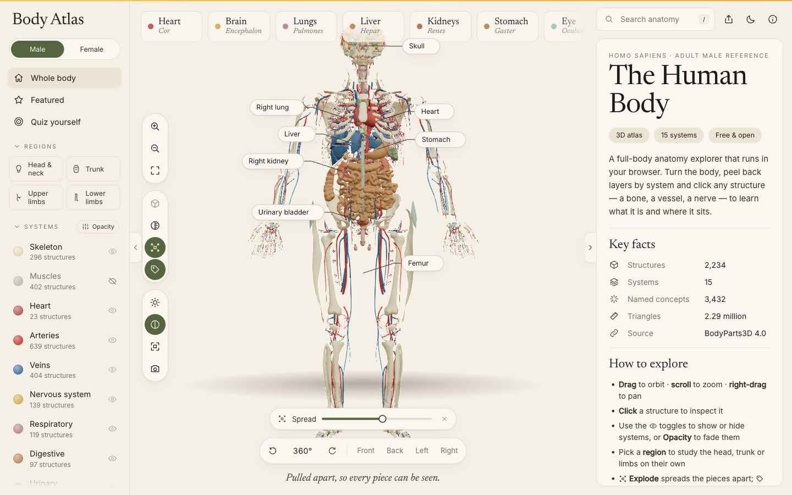</td>
    <td width="50%">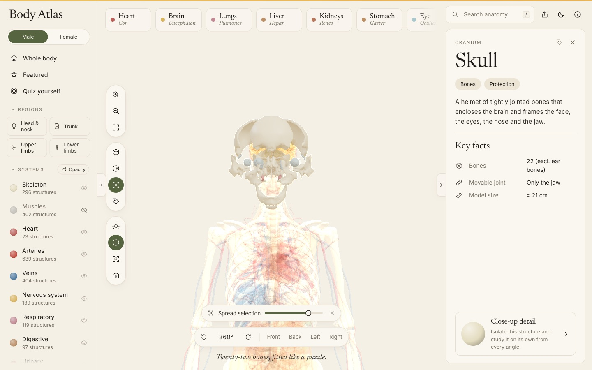</td>
  </tr>
  <tr>
    <td align="center"><sub><b>Exploded view</b> — the body pulled apart, labels follow</sub></td>
    <td align="center"><sub><b>Spread a selection</b> — the skull's 22 bones</sub></td>
  </tr>
  <tr>
    <td width="50%"></td>
    <td width="50%"></td>
  </tr>
  <tr>
    <td align="center"><sub><b>Organ deep-dive</b> — click a part to read about it</sub></td>
    <td align="center"><sub><b>Dark theme</b> — the brain, lobe by lobe</sub></td>
  </tr>
</table>

## ✦ Features

**See**
- **Whole-body model** — 2,234 meshes from BodyParts3D 4.0, grouped into 15 systems.
- **Male and female bodies** — switch between the BodyParts3D male and the HuBMAP female
  reference set (888 meshes, plus 1,646 fitted BodyParts3D bones, muscles, vessels, nerves and
  glands, so both bodies have every system); the choice is kept in the link as `?body=female`.
- **System layers** — show or hide any system; muscles and skin start hidden so the organs show.
- **Per-layer opacity** — fade each system on its own with a slider instead of all-or-nothing.
- **Exploded view** — spread the visible pieces apart, with a slider for how far; with a group
  selected (the skull, the spine) only that group spreads.
- **X-ray mode** — every layer turns translucent so you can see what sits behind what.
- **Ambient occlusion** — soft contact shadows where structures meet; one switch turns it off
  for slower devices (off by default on phones).
- **Preset views** — front, back, left, right, plus a 360° turntable.

**Find**
- **Browse by region** — head & neck, trunk, upper limbs, lower limbs, each with a per-system
  breakdown and places to start.
- **Search** — instant, across every structure and named group ("femur", "aorta", "left kidney").
- **Hover labels** — the name and system of whatever is under the mouse.
- **Pinned labels** — names attached to the model with leader lines; they follow the camera and
  the exploded view, stack so they never overlap, and open the structure on click.

**Learn**
- **Organ deep-dives** — 14 organs lift out of the body as labelled models; the heart beats and
  the lungs breathe while you read.
- **Quiz yourself** — eight "Find the …" rounds with hints and a final score.
- **One page per system and region** — static, readable pages that search engines can index,
  each linking into the 3D view.

**Use anywhere**
- **Fold-away panels** — hide the sidebar, the details or both (focus mode) for a full-width body.
  Collapsible sidebar groups. All remembered per browser.
- **Offline & installable** — a service worker keeps the app, the model and opened organs; install
  it from the browser as an app.
- **Shareable links**, **PNG export**, **light & dark themes**, **phone layout**.
- **Keyboard first**, **reduced motion** respected, **graceful fallback** without WebGL.

<table>
  <tr>
    <td width="33%">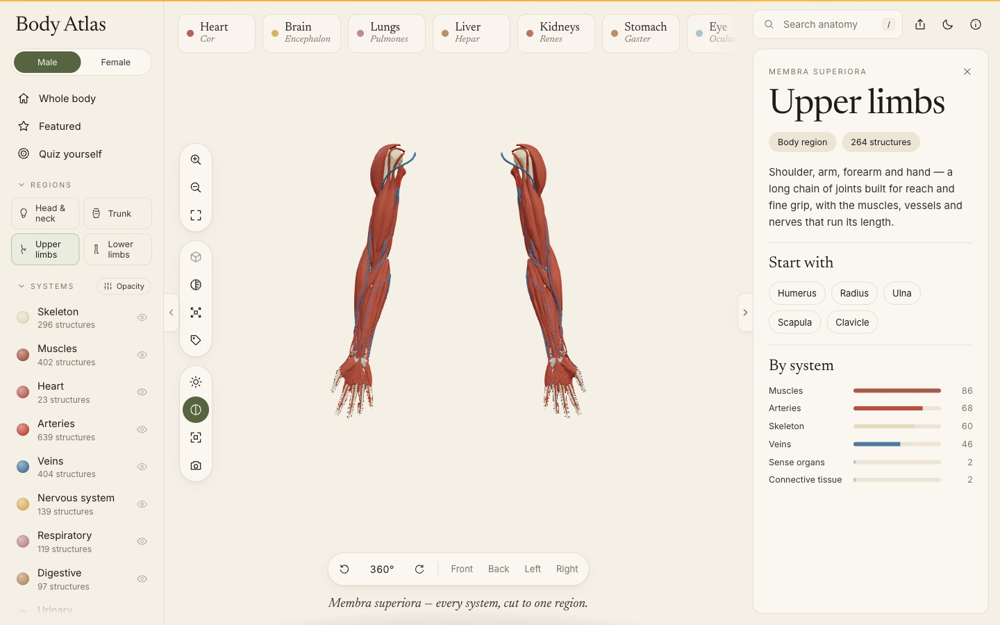</td>
    <td width="33%">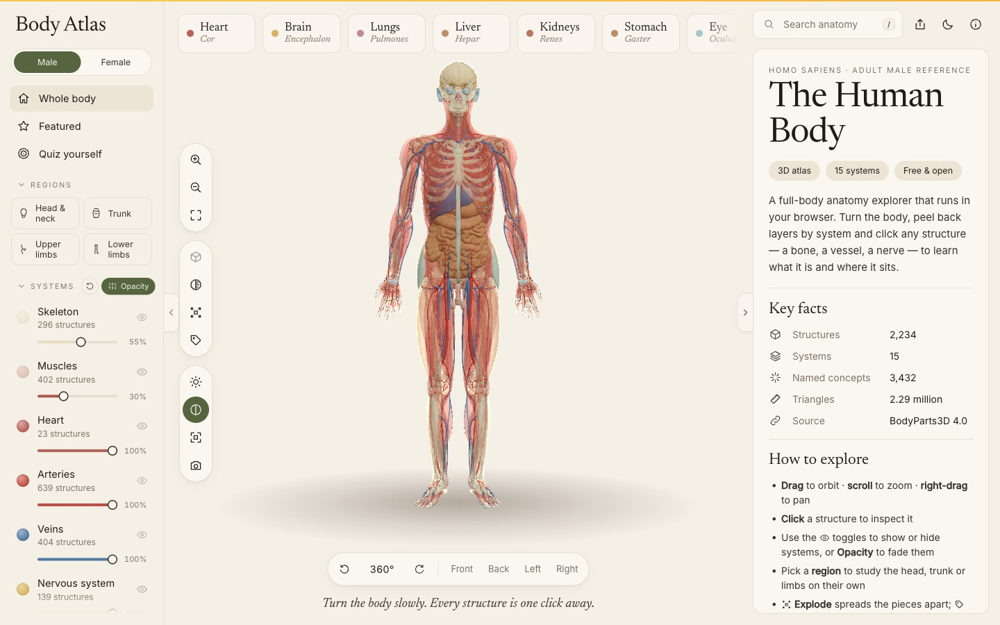</td>
    <td width="33%">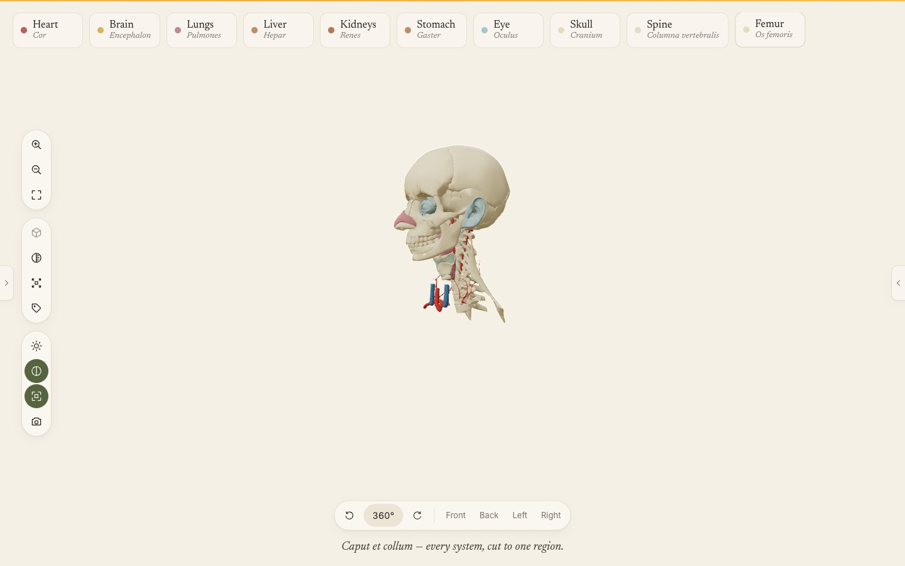</td>
  </tr>
  <tr>
    <td align="center"><sub><b>Regions</b> — the arms on their own</sub></td>
    <td align="center"><sub><b>Opacity</b> — muscles at 30 %</sub></td>
    <td align="center"><sub><b>Focus mode</b> — panels folded away</sub></td>
  </tr>
  <tr>
    <td width="33%"></td>
    <td width="33%"></td>
    <td width="33%">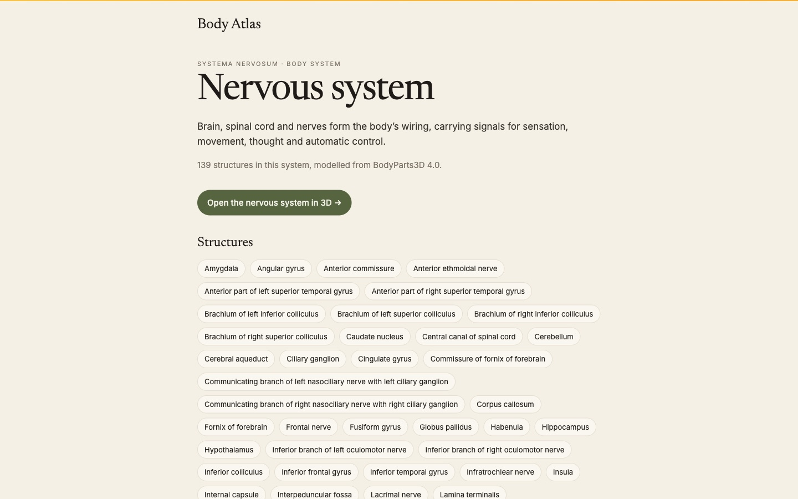</td>
  </tr>
  <tr>
    <td align="center"><sub><b>X-ray</b></sub></td>
    <td align="center"><sub><b>Quiz</b></sub></td>
    <td align="center"><sub><b>System page</b> — for search engines</sub></td>
  </tr>
</table>

<table>
  <tr>
    <td width="50%">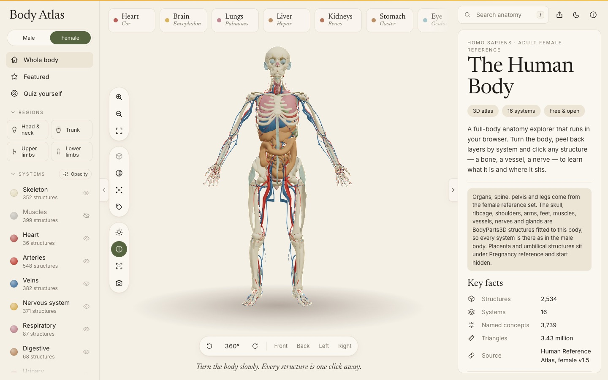</td>
    <td width="50%">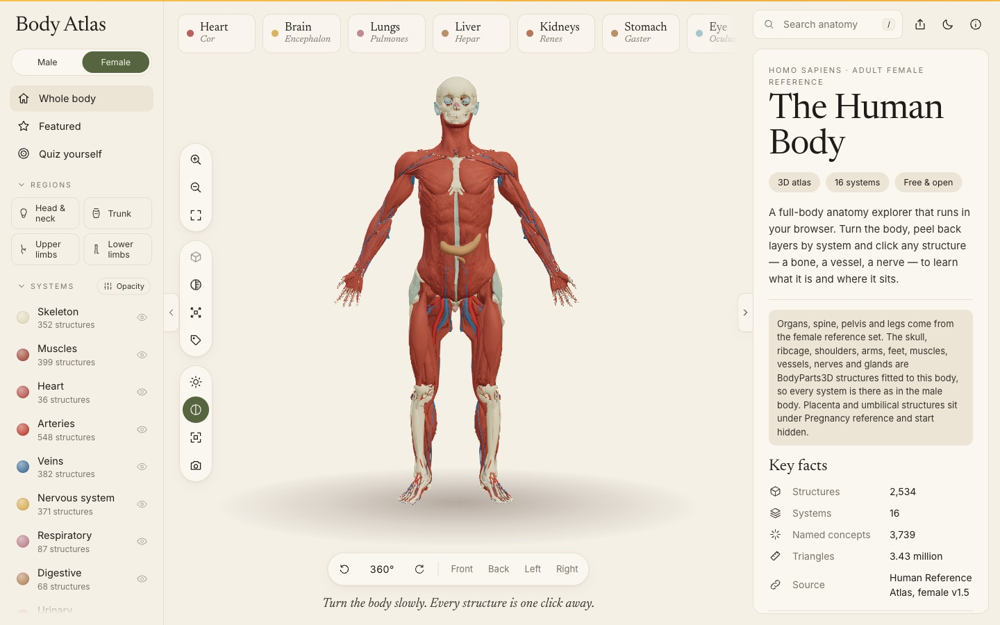</td>
  </tr>
  <tr>
    <td align="center"><sub><b>Female body</b> — the same systems as the male</sub></td>
    <td align="center"><sub><b>Female muscles</b> — fitted to her skeleton</sub></td>
  </tr>
</table>

## ✦ Quick start

> **Requires** Node.js 18+ and npm.

```bash
git clone https://github.com/ImliStack/Body-Atlas-3D.git
cd Body-Atlas-3D
npm install
npm run dev        # → http://localhost:5180
```

The first visit downloads ~31 MB of compressed geometry (15 chunks, with a progress bar);
after that it comes from the cache, and in a production build it works offline.

| Script | What it does |
|---|---|
| `npm run dev` | Dev server with hot reload on port 5180 |
| `npm run build` | Static production build into `dist/` — app, system/region pages, sitemap, service worker |
| `npm run preview` | Serve `dist/` locally on port 5180 |

## ✦ Using the atlas

<details open>
<summary><b>Explore the body</b></summary>
<br />

Drag to orbit · scroll to zoom · right-drag to pan. Click any structure to select it: the camera
flies in, the rest of the body fades back, and the panel shows its system, region, side, size and
the larger groups it belongs to. The **eye** icons in the sidebar switch systems on and off;
clicking a system's name focuses it with a short introduction.


</details>

<details>
<summary><b>Pull it apart, fade it, pin it</b></summary>
<br />

- **Exploded view** (<kbd>E</kbd>, or the burst icon) — every visible piece slides away from the
  centre, keeping its size, so gaps open between neighbours. Drag **Spread** to set how far.
  Select a group first — the skull, the spine, the rib cage — and only that group comes apart.
- **Opacity** — press **Opacity** next to *Systems* in the sidebar for a slider under each
  visible system; the circular arrow resets them all.
- **Pinned labels** (<kbd>N</kbd>, or the tag icon) — the first press pins eight landmarks. Pin
  anything else with the tag button in its panel. Click a label to open it, × to unpin. Labels
  hide when their structure is hidden or faded behind a selection.

</details>

<details>
<summary><b>Browse by region</b></summary>
<br />

Pick **Head & neck**, **Trunk**, **Upper limbs** or **Lower limbs** under *Regions*. Every system
is cut to that region, the camera frames it, and the panel lists how many structures each system
has there with a few good places to start. Click the region again (or **Whole body**) to go back.

</details>

<details>
<summary><b>Open an organ</b></summary>
<br />

Click an organ in the body or a quick pick along the top. The click flashes, the body steps
back, the camera springs in and a detailed model lifts out in the organ's place. Click its parts —
heart chambers, lung lobes, brain lobes — to read about each. **← Body** or <kbd>Esc</kbd> plays
the move in reverse.

Heart · brain · lungs · liver · kidneys · stomach · pancreas · spleen · gallbladder · bladder ·
eye · esophagus · intestines · larynx.

</details>

<details>
<summary><b>Quiz yourself</b></summary>
<br />

Choose **Quiz yourself** in the sidebar. Each round asks for one structure: a first-try find
scores 1, a second try ½, and after two misses the answer is shown with a hint. Hover and pinned
labels switch off during the quiz so they can't give the answer away.

</details>

<details>
<summary><b>Share a view</b></summary>
<br />

The URL hash follows what's open — copy it from the address bar or use the share button.

| Link | Opens |
|---|---|
| `#organ/heart` | An organ deep-dive (`heart`, `brain`, `lungs`, `liver`, …) |
| `#featured/skull` | A featured structure (`skull`, `spine`, `femur`) |
| `#concept/femur` | Any named group, lower-case and URL-encoded (`#concept/left%20kidney`) |
| `#part/FJ1252` | One mesh by its BodyParts3D id |
| `#system/venous` | A body-system overview |
| `#region/head` | A body region (`head`, `trunk`, `upper`, `lower`) |

Unknown links fall back to the whole body. Updates use `replaceState`, so clicking around
doesn't flood the browser history.

</details>

<details>
<summary><b>Offline & install</b></summary>
<br />

In a production build a service worker precaches the app shell and keeps every model chunk and
organ you open. After one full load the atlas opens with no connection. Chrome, Edge and Safari
offer **Install** / **Add to Home Screen**; it then opens in its own window.

</details>

## ✦ Keyboard shortcuts

| Key | Action | | Key | Action |
|:---:|---|---|:---:|---|
| <kbd>/</kbd> | Search | | <kbd>E</kbd> | Exploded view |
| <kbd>Esc</kbd> | Back / clear | | <kbd>N</kbd> | Pinned labels |
| <kbd>F</kbd> | Fit to view | | <kbd>X</kbd> | X-ray |
| <kbd>+</kbd> <kbd>−</kbd> | Zoom | | <kbd>I</kbd> | Isolate selection |
| <kbd>1</kbd> – <kbd>4</kbd> | Front · back · left · right | | <kbd>L</kbd> | Studio lighting |
| <kbd>R</kbd> | Auto-rotate | | <kbd>H</kbd> | Ambient occlusion |
| <kbd>[</kbd> | Show / hide sidebar | | <kbd>P</kbd> | Save image |
| <kbd>]</kbd> | Show / hide details | | <kbd>T</kbd> | Light / dark theme |
| <kbd>\\</kbd> | Focus mode (hide both) | | <kbd>?</kbd> | Shortcuts & credits |

In search, <kbd>↑</kbd> <kbd>↓</kbd> move through results and <kbd>Enter</kbd> opens one.

## ✦ How it works

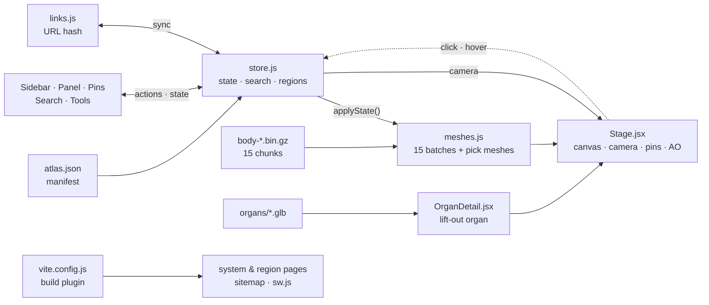

| Piece | Approach |
|---|---|
| **Geometry** | BodyParts3D meshes are pre-packed into 15 gzipped binary chunks plus a JSON manifest (names, systems, byte offsets, bounds). Three workers fetch them in parallel; `DecompressionStream` unzips them when the host hasn't; each part becomes a zero-copy `BufferGeometry`. |
| **Rendering** | One `THREE.BatchedMesh` per system draws everything that isn't selected — about 14 draw calls for the default view instead of ~1,830. Selected pieces are drawn on their own with the glow material. Per-system materials (solid · ghost · x-ray) are swapped per batch, and a system's opacity slider sets its material's opacity. |
| **Picking** | Each structure also keeps a plain mesh that is never drawn unless selected; these carry [three-mesh-bvh](https://github.com/gkjohnson/three-mesh-bvh) trees for hover and click. Trees are built in `requestIdleCallback` slices after load; faded layers are skipped so a click lands on what you can see. |
| **Exploded view** | Each piece moves by its offset from a centre, scaled per axis (`SPREAD` in `meshes.js`) — the batch instance matrix and the pick mesh move together, so picking and labels stay right. The spread eases in and out; the camera fits the grown box. |
| **Regions** | Each structure gets a region from the centre of its bounds (`regionIdOf` in `data.js`); the region filter is one more condition in `applyState()`. |
| **Pinned labels** | DOM labels over the canvas. A projector inside the scene moves them every frame, outside React: the anchor is the (exploded) centre of the structure, the label sits out to the side, same-side labels are stacked 30 px apart, and an SVG polyline draws the leader. |
| **Camera** | [camera-controls](https://github.com/yomotsu/camera-controls) (via drei) handles fly-to, fit-to-box and preset views, padding small structures so a single tooth still shows its jaw. |
| **Post effects** | [N8AO](https://github.com/N8python/n8ao) ambient occlusion + SMAA through [@react-three/postprocessing](https://github.com/pmndrs/react-postprocessing), loaded only when high quality is on. |
| **State** | One [zustand](https://github.com/pmndrs/zustand) store holds selection, layers, opacity, region, spread, pins, quiz, panels, theme and camera commands. Every selection runs the same timeline: *press → clear → fly → lift → reveal → hold*. |
| **Pages & offline** | A small Vite plugin writes `systems/<id>/` and `regions/<id>/` pages (title, description, JSON-LD, structure list, link into the 3D view), `sitemap.xml`, `robots.txt` and `sw.js` with the built file list. The service worker is network-first for pages and cache-first for assets, models and organs. |
| **Motion** | Every duration lives in [`src/motion.js`](src/motion.js). The organ lift is a damped spring with slight overshoot; heartbeat and breathing are small procedural scale curves. |

## ✦ Project structure

```text
Body-Atlas-3D/
├── index.html                  App shell, fonts, meta tags, manifest link
├── package.json
├── vite.config.js              Build plugin: system/region pages, sitemap, service worker
├── wrangler.jsonc              Cloudflare static-assets deploy
├── scripts/                    README screenshots + demo recording
├── PLAN.md                     Research notes and milestones
├── docs/
│   ├── logo.svg
│   ├── demo.gif · demo.mp4     README demo
│   └── screenshots/            Images used in this README
├── public/
│   ├── ATTRIBUTION.md          Full data credits
│   ├── manifest.webmanifest    Install metadata
│   ├── icon.svg · icon-*.png   App icons
│   ├── models/
│   │   ├── atlas.json          Manifest: parts, systems, offsets, bounds
│   │   └── body-*.bin.gz       15 packed geometry chunks
│   └── organs/
│       ├── *.glb               14 organ models
│       └── ATTRIBUTION.md      Per-model licences
└── src/
    ├── main.jsx                React entry, service worker registration
    ├── App.jsx                 Layout, search, quick picks, tools, spread bar, shortcuts, loader
    ├── store.js                Zustand store, search + region index, selection timeline, pins, quiz
    ├── links.js                URL hash ⇄ current view
    ├── data.js                 Systems, regions, colours, featured structures, quiz rounds
    ├── organs.js               Organ copy, facts, idle animation, quick picks
    ├── organ-models.json       Organ parts, groups, colours, credits
    ├── motion.js               All timings + spring / heartbeat / breathing
    ├── styles.css              Design tokens (light + dark), layout, components
    ├── scene/
    │   ├── Stage.jsx           Canvas, lights, picking, camera rig, pin projector, PNG export
    │   ├── meshes.js           Chunk loading, batches, materials, BVH, explode, opacity, applyState()
    │   ├── Effects.jsx         Ambient occlusion + SMAA (lazy-loaded)
    │   ├── OrganDetail.jsx     Lifted-out organ: fade, spring, idle, part picking
    │   ├── organLoader.js      Cached GLB loading
    │   └── fx.js               Shared animated values (fade, flash, dissolve, spread)
    └── ui/
        ├── Sidebar.jsx         Navigation, regions, system layers + opacity, collapsible groups
        ├── Panel.jsx           Overview, system, region, selection, organ and quiz views
        ├── Pins.jsx            Pinned labels and leader lines
        ├── PanelToggles.jsx    Edge handles that fold the side panels
        └── Icon.jsx            24 px stroke icon set
```

**Where to start reading:** [`src/store.js`](src/store.js) for behaviour,
[`src/scene/meshes.js`](src/scene/meshes.js) for the 3D body,
[`src/ui/Panel.jsx`](src/ui/Panel.jsx) for what the right column shows.

## ✦ Customising

| To… | Edit |
|---|---|
| Add a quiz round | `QUIZ` in [`src/data.js`](src/data.js) — title, BodyParts3D concept names, system, hint |
| Change the quick picks | `PICKS` at the end of [`src/organs.js`](src/organs.js) |
| Change the default pinned labels | `DEFAULT_PINS` in [`src/store.js`](src/store.js) |
| Change how far pieces spread | `SPREAD` in [`src/scene/meshes.js`](src/scene/meshes.js) |
| Move a region boundary | `regionIdOf` in [`src/data.js`](src/data.js) |
| Retune an animation | The value in [`src/motion.js`](src/motion.js) — every move reads from there |
| Re-colour a system | Its `color` in `SYSTEMS` in [`src/data.js`](src/data.js) — 3D materials and UI follow |
| Change theme colours | CSS custom properties at the top of [`src/styles.css`](src/styles.css) (`:root[data-theme='dark']` for dark) |

## ✦ Browser support & deployment

Works in current **Chrome, Edge, Firefox and Safari** on desktop and mobile; WebGL must be
available (it is unless hardware acceleration is off). Device pixel ratio is capped at 2; the
**ambient occlusion** switch (<kbd>H</kbd>) helps on slower machines.

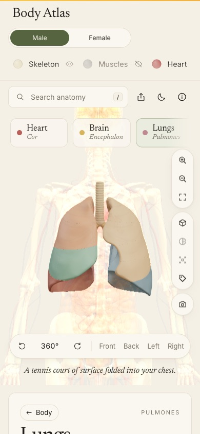

`npm run build` emits a fully static site in `dist/` — deploy it to **Cloudflare (Pages or
Workers), Vercel, Netlify or GitHub Pages** with no server and no environment variables. On
Cloudflare Workers Builds, [`wrangler.jsonc`](wrangler.jsonc) serves `dist/` as static assets
(build: `npm run build`, deploy: `npx wrangler deploy`) — without it, wrangler tries to
auto-configure the project and stops because that needs Vite 6. Set `SITE_URL` at build time if
the site lives somewhere other than the default, so canonical links and the sitemap point there.
Hosts that serve `.gz` with `Content-Encoding: gzip` and hosts that serve it as plain binary
both work.

<br clear="right" />

## ✦ FAQ

<details>
<summary><b>Why is the first load ~31 MB?</b></summary>
<br />
The model is real scan-derived anatomy — 2.29 million triangles — not a stylised mannequin.
It streams in 15 chunks with a progress bar and is cached afterwards, so later visits (and
offline ones) start from the cache.
</details>

<details>
<summary><b>Can I use it for medical decisions?</b></summary>
<br />
No. It is a learning tool built on two reference bodies, one male and one female. Real anatomy varies
between people.
</details>

<details>
<summary><b>Is there a female body?</b></summary>
<br />
Yes. Use the <b>Male / Female</b> switch under the logo, or open <code>/?body=female</code>.
The female body is the HuBMAP 3D Reference Organ Set for Female v1.5 (CC BY 4.0): 888 meshes
with detailed organs and reproductive anatomy. That set's skeleton stops at the spine, pelvis
and legs, so the skull, ribcage, shoulders, arms and feet are BodyParts3D bones fitted to the
female body: the skull to her brain, eyes and neck, the ribcage to her lungs and spine, the arms
swung into her pose, the feet set under her shins. Muscles, vessels, nerves and glands she lacks
follow the bones around them onto her body, like skinning
(<code>scripts/build-female-skeleton.mjs</code>), so the systems match the male body. These fitted
parts are approximations, not female scan data. Placenta and umbilical structures are grouped under <i>Pregnancy reference</i> and start hidden.
</details>

<details>
<summary><b>Why no 3D on my machine?</b></summary>
<br />
Your browser has WebGL switched off — usually hardware acceleration is disabled. The rest of
the atlas still works and the page tells you what to change.
</details>

## ✦ Roadmap

- [x] Whole-body model, system layers, search, selection
- [x] Organ deep-dives with labelled parts and idle motion
- [x] Hover labels, preset views, x-ray, quiz, shareable links, PNG export, dark theme
- [x] Exploded view that spreads the visible pieces apart (or just the selection)
- [x] Browse by region — head & neck, trunk, upper and lower limbs
- [x] Labels pinned to the model with leader lines
- [x] Per-layer opacity sliders
- [x] Fewer draw calls — one batched mesh per system (~1,830 → ~14)
- [x] One static page per system and region, sitemap, offline cache and install (PWA)
- [x] Fold-away panels, focus mode, collapsible sidebar groups, ambient occlusion
- [x] Female reference body (HuBMAP Female Reference Organs, CC BY 4.0) with a body switcher
- [ ] Cross-sections (clipping planes) through any axis
- [ ] Guided tours that chain views, pins and captions

Research notes and earlier milestones are in [PLAN.md](PLAN.md).

## ✦ Screenshots & demo

Every image and the demo in this README are generated from the running app:

```bash
npm run dev                    # keep running on :5180
scripts/readme-shots.sh        # refreshes docs/screenshots/*.jpg
scripts/readme-video.sh        # records docs/demo.mp4 + docs/demo.gif (needs ffmpeg)
```

Both use the gstack `browse` CLI in headed mode (WebGL needs a real GPU). The system-page shot
also needs `npm run build && npx vite preview --port 5190`. For an inline video player instead
of the GIF, drag `docs/demo.mp4` into the README in GitHub's web editor — GitHub hosts it and
plays it in place.

## ✦ Contributing

Issues and pull requests are welcome.

1. Fork the repo and create a branch: `git checkout -b feature/your-idea`
2. Run `npm run dev` and make your change
3. Check `npm run build` passes
4. Open a pull request describing what changed and why

## ✦ Data & credits

| Source | What | Licence |
|---|---|---|
| [BodyParts3D 4.0](https://lifesciencedb.jp/bp3d/) — © DBCLS | Whole-body anatomy | CC BY 4.0 |
| [HuBMAP 3D Reference Organ Set for Female v1.5](https://doi.org/10.48539/HBM352.BTSQ.586) — Browne & Schlehlein | Female reference body | CC BY 4.0 |
| [ashemag/human-atlas](https://github.com/ashemag/human-atlas) | Packed browser geometry | MIT code · CC BY 4.0 data |
| [OrganUI](https://github.com/organui) | Organ models | MIT code · CC BY 4.0 / CC BY-SA per model |
| [three.js](https://threejs.org), [React Three Fiber](https://github.com/pmndrs/react-three-fiber), [drei](https://github.com/pmndrs/drei), [postprocessing](https://github.com/pmndrs/postprocessing), [three-mesh-bvh](https://github.com/gkjohnson/three-mesh-bvh) | 3D rendering and picking | MIT |
| Google Fonts | Newsreader, Inter | OFL |

Full attribution: [`public/ATTRIBUTION.md`](public/ATTRIBUTION.md) and
[`public/organs/ATTRIBUTION.md`](public/organs/ATTRIBUTION.md).

> [!IMPORTANT]
> **Educational use only.** Body Atlas is a learning tool, not a clinical or diagnostic
> reference.

<div align="center">
<br />
<sub>Made with care by <a href="https://github.com/ImliStack">ImliStack</a></sub>
</div>
